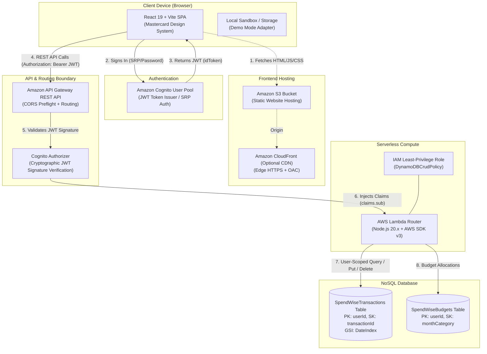

# SpendWise — AWS Cloud Personal Finance Tracker

[](https://nodejs.org/)
[](https://react.dev/)
[](https://aws.amazon.com/serverless/)
[](./DESIGN.md)

**SpendWise** is a personal finance tracker web application built for college cloud computing mini-projects, viva demonstrations, and production serverless architectures. It combines an editorial fintech design system inspired by Mastercard (`DESIGN.md`) with a real AWS serverless backend comprising Amazon S3, Amazon API Gateway, AWS Lambda, Amazon DynamoDB, and Amazon Cognito.

---

## Table of Contents
1. [Project Overview & Key Features](#1-project-overview--key-features)
2. [Architecture Diagram (Mermaid)](#2-architecture-diagram)
3. [AWS Services & Rationale](#3-aws-services--rationale)
4. [Prerequisites](#4-prerequisites)
5. [Local Development & Demo Mode](#5-local-development--demo-mode)
6. [Deploying Backend Infrastructure (AWS SAM)](#6-deploying-backend-infrastructure-aws-sam)
7. [Building & Deploying Frontend to Amazon S3](#7-building--deploying-frontend-to-amazon-s3)
8. [Configuring Amazon Cognito & User Sign-In](#8-configuring-amazon-cognito--user-sign-in)
9. [REST API Endpoints & Examples](#9-rest-api-endpoints--examples)
10. [Lab Viva Testing & Screenshot Guide](#10-lab-viva-testing--screenshot-guide)
11. [Troubleshooting & Common Errors](#11-troubleshooting--common-errors)
12. [Cleanup Instructions (Avoid AWS Charges)](#12-cleanup-instructions)
13. [Limitations & Future Enhancements](#13-limitations--future-enhancements)

---

## 1. Project Overview & Key Features

- **Modern Editorial UI/UX**: Warm putty-cream canvas (`#F3F0EE`), lifted paper layers, stadium containers (40px radius), floating pill navigation, circular portraits with attached satellite micro-CTAs, and Sofia Sans typography.
- **Indian Financial Context (INR ₹)**: Native formatting with Indian numbering system (`1,25,000`), default rupee currency symbol (`₹`), and integer paise mathematical precision.
- **Financial Dashboard**: Real-time Net Balance, Total Monthly Inflow, Total Outflow, and Savings Rate target meter.
- **Transaction Ledger**: Create, View, Edit, Delete, Search, Filter (Category, Flow Type, Date), and Sort transactions with CSV & JSON data export.
- **Monthly Category Budgets**: Set spending limits per category (Food, Bills, Transport, etc.) with dynamic color-coded progress bars (Green < 70%, Amber 70–99%, Red ≥ 100% with warning pills).
- **Spending Analytics**: Pure SVG 6-Month Income vs Outflow historical trend chart, Category Allocation Donut chart with hover tooltips, and Daily Burn Rate calculation.
- **Isolated User Security**: Strict user-scoped DynamoDB partitioning based on verified Amazon Cognito JWT claims (`sub`).
- **Dual Runtime Modes**:
  1. **Local Demo Mode**: Browser-based sandbox with preloaded realistic student finance data and zero cloud setup required.
  2. **AWS Cloud Connected Mode**: Real-time synchronization with Amazon DynamoDB and Amazon Cognito.

---

## 2. Architecture Diagram



---

## 3. AWS Services & Rationale

| Service | Role in SpendWise | Architectural Rationale |
| :--- | :--- | :--- |
| **Amazon S3** | Static website hosting for compiled React SPA bundle. | Low latency, high availability, zero server maintenance, cost-effective static distribution. |
| **Amazon Cognito** | User registration, password hashing, email verification, and JWT issuance. | Offloads identity security; adheres to OAuth2/OIDC standards without storing plain passwords in databases. |
| **Amazon API Gateway** | Managed REST entrypoint with routing, CORS handling, and Cognito Authorizer. | Protects Lambda from unauthenticated requests; handles rate limiting and HTTPS termination. |
| **AWS Lambda** | Event-driven compute running business logic in Node.js 20.x. | True serverless: auto-scales with zero idle cost; enforces integer paise math and JWT claims extraction. |
| **Amazon DynamoDB** | Persistent NoSQL storage with Pay-Per-Request (On-Demand) billing. | Millisecond latency at any scale; natural user partitioning with `userId` as Partition Key; zero base cost. |

---

## 4. Prerequisites

- **Node.js**: v20.x or higher (`node -v`)
- **npm**: v10.x or higher (`npm -v`)
- **AWS CLI** *(for deployment)*: Configured with `aws configure`
- **AWS SAM CLI** *(for deployment)*: `sam --version` ≥ 1.100.0

---

## 5. Local Development & Demo Mode

SpendWise includes an integrated local development sandbox that works right out of the box with realistic student demo data (no AWS credentials required).

```bash
# 1. Clone repository and navigate to folder
cd d:/spendWise

# 2. Install dependencies
npm install

# 3. Start local development server
npm run dev
```

Visit **`http://localhost:5173/`** in your browser.

> 💡 **Demo Mode Banner:** When AWS configuration is absent, SpendWise prominently displays an amber banner:  
> *`Demo Mode — Local Browser Storage: Data is stored locally in your browser sandbox, not in AWS DynamoDB.`*  
> Real cloud mode never silently falls back to mock data on network errors.

### Running Backend Unit Tests
SpendWise includes a test suite using Node's built-in test runner:
```bash
node --test backend/tests/backend.test.js
```
*Expected: 11 passing tests (0 failures) covering transaction validation, paise conversion, budget calculations, and Cognito JWT isolation.*

---

## 6. Deploying Backend Infrastructure (AWS SAM)

The SAM template (`infrastructure/template.yaml`) provisions Cognito, DynamoDB, API Gateway, Lambda, and S3.

```bash
# 1. Build SAM Application
sam build -t infrastructure/template.yaml

# 2. Deploy using Guided Mode
sam deploy --guided
```

### Guided Prompts:
- **Stack Name**: `spendwise-backend`
- **AWS Region**: `ap-south-1` *(Asia Pacific - Mumbai)*
- **Parameter Stage**: `prod`
- **Parameter AllowedOrigin**: `*` *(or your S3 website URL)*
- **Allow SAM CLI to create IAM roles**: `Y`

Record the **Outputs** generated upon deployment:
- `ApiEndpoint`
- `CognitoUserPoolId`
- `CognitoClientId`
- `FrontendWebsiteURL`

---

## 7. Building & Deploying Frontend to Amazon S3

### Step 7.1: Set Environment Variables
Create `.env` in the project root:
```env
VITE_API_ENDPOINT=https://your-api-id.execute-api.ap-south-1.amazonaws.com/prod
VITE_COGNITO_USER_POOL_ID=ap-south-1_xxxxxxxxx
VITE_COGNITO_CLIENT_ID=xxxxxxxxxxxxxxxxxxxxxxxxxx
VITE_AWS_REGION=ap-south-1
```

### Step 7.2: Build the Production Bundle
```bash
npm run build
```

### Step 7.3: Sync Bundle to S3 Hosting Bucket
```bash
aws s3 sync dist/ s3://spendwise-frontend-prod-<YOUR-ACCOUNT-ID> --delete
```

Open `FrontendWebsiteURL` in your browser.

---

## 8. Configuring Amazon Cognito & User Sign-In

1. In the SpendWise UI, click **Sign In** (or click the mode badge in the navigation bar).
2. Switch to **Create Account**:
   - Provide Full Name, Email, and a password (min 8 characters, uppercase, numbers).
   - Cognito automatically dispatches a 6-digit verification code to the registered email.
3. Switch to **Verify Code** and submit the 6-digit confirmation code.
4. Sign in with your credentials. SpendWise automatically transitions to **AWS Live Connected** mode!

---

## 9. REST API Endpoints & Examples

Full specification available in [`docs/api.md`](./docs/api.md).

### Sample Request: Create Transaction
```bash
curl -X POST https://your-api.execute-api.ap-south-1.amazonaws.com/prod/transactions \
  -H "Authorization: Bearer <COGNITO_ID_TOKEN>" \
  -H "Content-Type: application/json" \
  -d '{
    "type": "expense",
    "amount": 249.00,
    "category": "Food",
    "description": "Lunch at College Canteen",
    "transactionDate": "2026-10-27"
  }'
```

### Sample Response:
```json
{
  "message": "Transaction recorded successfully",
  "data": {
    "id": "c1f7a2b9-e4a1-4682-824c-90b1c092a71f",
    "userId": "3c98f4e2-9b51-4091-a1e6-8e5048d08cb2",
    "type": "expense",
    "amount": 24900,
    "category": "Food",
    "description": "Lunch at College Canteen",
    "transactionDate": "2026-10-27"
  }
}
```

---

## 10. Lab Viva Testing & Screenshot Guide

Detailed checklist and model viva answers in [`docs/lab-demo-checklist.md`](./docs/lab-demo-checklist.md).

### Key Evidence to Capture for Your Lab Report:
1. **S3 Static Website Hosting**: S3 bucket properties with website endpoint enabled.
2. **Cognito User Directory**: Registered user emails and confirmation status in AWS Console.
3. **API Gateway Authorizer**: Cognito Authorizer linked to protected routes.
4. **CloudWatch Logs**: `/aws/lambda/SpendWiseFunction` execution logs showing JWT claim extraction.
5. **DynamoDB Items Explorer**: Table items displaying `amount` in integer paise and `DateIndex` GSI.
6. **Multi-User Isolation**: Evidence that User B cannot view User A's financial transactions.

---

## 11. Troubleshooting & Common Errors

| Issue / Error | Likely Cause | Solution |
| :--- | :--- | :--- |
| **`401 Unauthorized`** | Missing or expired Cognito JWT token. | Sign in again through Cognito to refresh tokens. |
| **`CORS Preflight Error`** | API Gateway OPTIONS method not returning allowed headers. | Verify `AllowedOrigin` in SAM template and redeploy stack. |
| **`UserNotConfirmedException`** | User registered but hasn't entered 6-digit email code. | Enter confirmation code in the Auth modal or confirm manually in AWS Cognito console. |
| **`AccessDenied` on S3 Website URL** | Bucket policy missing or public access block active. | Ensure bucket policy allows `s3:GetObject` for `*` on `arn:aws:s3:::bucket-name/*`. |
| **Floating point math drift** | Direct rupee decimal additions. | SpendWise avoids this by strictly storing integer paise (`₹1.00 = 100 paise`). |

---

## 12. Cleanup Instructions

To completely delete cloud resources and avoid ongoing AWS charges:

```bash
# 1. Empty S3 frontend bucket
aws s3 rm s3://spendwise-frontend-prod-<YOUR-ACCOUNT-ID> --recursive

# 2. Delete SAM CloudFormation stack
sam delete --stack-name spendwise-backend --no-prompts
```

---

## 13. Limitations & Future Enhancements

- **Current Limitations**: Manual transaction entry (does not integrate with live open banking APIs for security and educational scope).
- **Future Enhancements**:
  - Receipt image scanning via Amazon Textract / AWS Rekognition.
  - Automated recurring transaction schedulers using Amazon EventBridge.
  - AI-driven financial advice summaries using Amazon Bedrock.

---

## 14. Documentation Links

- [Cloud Architecture Specification](./docs/architecture.md)
- [REST API Reference](./docs/api.md)
- [Step-by-Step AWS Deployment Guide](./docs/aws-deployment.md)
- [Lab Demo & Viva Checklist](./docs/lab-demo-checklist.md)
- [Mastercard Design System Guide](./DESIGN.md)
