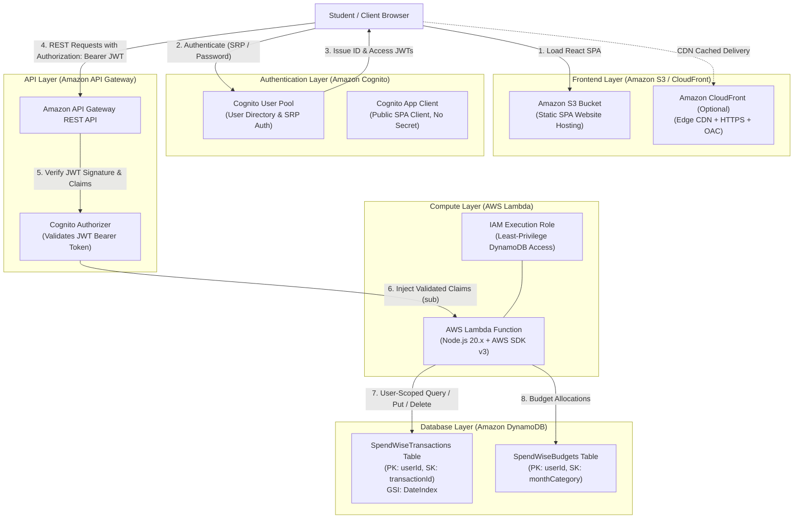

# SpendWise — AWS Cloud Architecture Documentation

## 1. System Overview

**SpendWise** is a personal finance tracker built on AWS Serverless architecture and designed with a Mastercard-inspired editorial design system. The system strictly separates concerns into a static Single Page Application (SPA) frontend, an API Gateway REST boundary, a stateless Node.js AWS Lambda compute layer, and Amazon DynamoDB NoSQL persistent storage, with Amazon Cognito handling user authentication.



---

## 2. AWS Services Used & Rationale

| Service | Why Used | Key Configuration Details |
| :--- | :--- | :--- |
| **Amazon S3** | Serverless static asset hosting for the built Vite + React production bundle. | Bucket configured for static website hosting with `index.html` as both index and error document (for client-side routing). |
| **Amazon Cognito** | Secure user management without storing passwords in custom databases. | User Pool with email sign-in, self-registration, and email verification. Web client without client secret for browser execution. |
| **Amazon API Gateway** | Managed REST entry point handling HTTP routing, CORS preflights, and token verification. | Cognito User Pool Authorizer configured on protected routes; OPTIONS preflight handled cleanly. |
| **AWS Lambda** | Event-driven compute that scales to zero with zero idle cost. | Node.js 20.x runtime using AWS SDK v3 (`@aws-sdk/client-dynamodb` and `@aws-sdk/lib-dynamodb`). |
| **Amazon DynamoDB** | Fully managed NoSQL database providing sub-10ms latency. | On-Demand (PAY_PER_REQUEST) billing to prevent recurring costs. Strong user isolation using Partition Key `userId`. |

---

## 3. Data Model & DynamoDB Schema

### 3.1. Design Decisions: Multi-Table vs Single-Table Pattern
For college lab presentations and viva examiners, SpendWise adopts a **Two-Table Schema** (`SpendWiseTransactions` and `SpendWiseBudgets`). This structure is exceptionally clear to inspect in the AWS Management Console during examinations while preserving high-performance query patterns without full table scans.

*(Note: In production enterprise environments, this can also be unified into a Single-Table Design using `PK: USER#<sub}>` and `SK: TX#<id>` or `BUDGET#<month>#<category>` as explained in Section 3.4).*

### 3.2. `SpendWiseTransactions` Table
- **Partition Key (PK)**: `userId` (String) — The unique Cognito user `sub`.
- **Sort Key (SK)**: `transactionId` (String) — Unique UUID (e.g. `tx-9f8a-4b1c`).
- **Global Secondary Index (GSI)**: `DateIndex`
  - **GSI PK**: `userId` (String)
  - **GSI SK**: `transactionDate` (String, format: `YYYY-MM-DD`)
  - **Projection**: `ALL`
  - **Purpose**: Enables querying all transactions for a user sorted chronologically (newest first) or filtered by date range without performing expensive table scans.

#### Item Schema Example:
```json
{
  "userId": "3c98f4e2-9b51-4091-a1e6-8e5048d08cb2",
  "transactionId": "d8e3b1c2-9014-4e2a-a5f1-32b0c9a812e4",
  "id": "d8e3b1c2-9014-4e2a-a5f1-32b0c9a812e4",
  "type": "expense",
  "amount": 14950,
  "category": "Food",
  "description": "South Indian Thali Lunch",
  "transactionDate": "2026-10-27",
  "createdAt": "2026-10-27T12:30:00.000Z",
  "updatedAt": "2026-10-27T12:30:00.000Z"
}
```

> **Integer Paise Representation:** The `amount` attribute is stored strictly as an **integer number of paise** (`14950` paise = `₹149.50`). This completely eliminates JavaScript IEEE-754 floating-point accumulation errors common in financial calculations.

---

### 3.3. `SpendWiseBudgets` Table
- **Partition Key (PK)**: `userId` (String) — The Cognito user `sub`.
- **Sort Key (SK)**: `monthCategory` (String) — Composite key: `<YYYY-MM>#<Category>` (e.g. `2026-10#Food`).

#### Item Schema Example:
```json
{
  "userId": "3c98f4e2-9b51-4091-a1e6-8e5048d08cb2",
  "monthCategory": "2026-10#Food",
  "month": "2026-10",
  "category": "Food",
  "amount": 1200000,
  "createdAt": "2026-10-01T00:00:00.000Z",
  "updatedAt": "2026-10-01T00:00:00.000Z"
}
```

---

### 3.4. Query Access Patterns

| Access Pattern | Target Table / Index | Key Condition | Filter / Note |
| :--- | :--- | :--- | :--- |
| **Get All User Transactions** | `SpendWiseTransactions` | `userId = :sub` | Scoped to authenticated user |
| **Filter by Date Range** | `DateIndex` GSI | `userId = :sub AND transactionDate BETWEEN :start AND :end` | Sorted descending |
| **Filter by Category** | `SpendWiseTransactions` | `userId = :sub` | `category = :cat` |
| **Get Single Transaction** | `SpendWiseTransactions` | `userId = :sub AND transactionId = :id` | Atomic GetItem (Key) |
| **Get Monthly Budgets** | `SpendWiseBudgets` | `userId = :sub` | `month = :month` |
| **Upsert Category Budget** | `SpendWiseBudgets` | `userId = :sub AND monthCategory = :mc` | Atomic PutItem |

---

## 4. Security & User Identity Isolation

### 4.1. Token Verification at the API Boundary
1. The frontend authenticates directly against the Amazon Cognito User Pool and receives a cryptographically signed JSON Web Token (JWT).
2. All API requests pass this token in the standard HTTP header:
   ```http
   Authorization: Bearer <id_or_access_token>
   ```
3. Amazon API Gateway uses an integrated **Cognito User Pool Authorizer** that validates the cryptographic signature against Cognito's JSON Web Key Set (JWKS), verifies token expiration, and confirms audience (`aud`).
4. Requests with invalid or missing tokens are rejected at the API Gateway layer with HTTP 401 before any Lambda execution costs are incurred.

### 4.2. Safe Derivation of User Identity in Lambda
The backend handler never trusts a `userId` supplied in the HTTP request body or query parameters. The identity is derived strictly from validated JWT claims provided by the authorizer context:

```javascript
// backend/src/handler.js
const userId = event.requestContext?.authorizer?.claims?.sub;
if (!userId) {
  return buildResponse(401, { error: 'Unauthorized', message: 'Invalid token claims' });
}
```

Every database operation enforces `userId` as the partition key, making it mathematically impossible for one user to access or mutate another user's financial records.

---

## 5. Monetary Arithmetic: Integer Paise Standard

Monetary values in software systems must avoid floating-point inaccuracies (e.g. `0.1 + 0.2 === 0.30000000000000004`). SpendWise adheres to the standard banking practice:

1. **Client UI**: Accepts input in Rupees (₹) and formats outputs using `Intl.NumberFormat('en-IN')`.
2. **Transmission**: Sent as decimal or integer.
3. **Database & Calculations**: Converted to integer paise:
   $$\text{Paise} = \text{Math.round}(\text{Rupees} \times 100)$$
4. **Calculations**: All additions, subtractions, and budget thresholds operate on integer paise.

---

## 6. S3 Website Hosting vs. CloudFront Distribution

SpendWise documents both deployment options:

1. **Lab & Educational Setup (Amazon S3 Static Website Hosting)**:
   - Quick to deploy for a college lab demonstration.
   - S3 bucket configured with `WebsiteConfiguration`.
   - Clear trade-off: uses public read bucket policy appropriate for educational testing.
2. **Production Setup (Amazon CloudFront with Origin Access Control - OAC)**:
   - S3 bucket remains completely private (`BlockPublicAccess: true`).
   - CloudFront edge distribution serves content globally over HTTPS.
   - Origin Access Control (OAC) signs requests so S3 only allows access from CloudFront.
